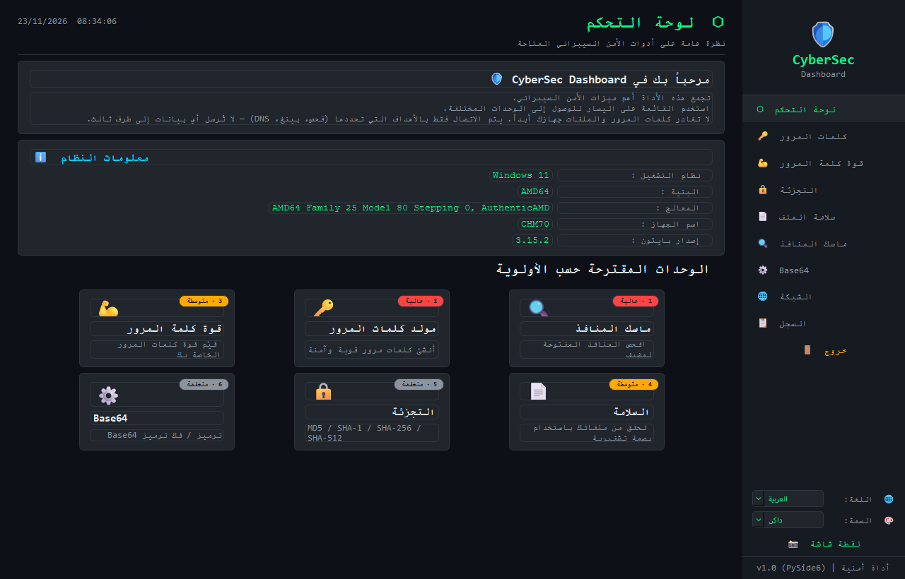

# لوحة تحكم الأمان السيبراني

[](https://github.com/CHM2026/Local-Cybersec-Partner/actions/workflows/python-app.yml)
[](https://www.python.org/downloads/)
[](https://pypi.org/project/PySide6/)
[](https://github.com/CHM2026/Local-Cybersec-Partner/actions/workflows/python-app.yml)
[](https://github.com/CHM2026/Local-Cybersec-Partner/releases/latest)
[](https://github.com/CHM2026/Local-Cybersec-Partner/actions/workflows/python-app.yml)

> اللغات: [Français](README.md) · [English](README.en.md) · **العربية**

لوحة تحكم محلية تجمع عدة أدوات الأمان السيبراني، مبنية باستخدام **PySide6**.

## معاينة

داكن (السمة الأصلية):



فاتح 2026:


> ⚠️ **المتطلب: Python 3.15 أو أحدث.** يستخدم الكود صيغة `lazy import` (PEP 810) والسلاسل النصية المتداخلة f-strings (PEP 701). على Python ≤ 3.14 يفشل التشغيل مع ظهور `SyntaxError`.

## التثبيت

مطلوب Python 3.15 أو أحدث. حسب نظام التشغيل:

```powershell
# Windows (PowerShell)
python -m venv .venv
.\.venv\Scripts\python.exe -m pip install -r requirements.txt
```

```bash
# macOS / Linux
python3 -m venv .venv
./.venv/bin/python -m pip install -r requirements.txt
```

على Windows، إذا كان `python` يشير إلى إصدار أقدم، استخدم `py -3.15` بدلاً منه.

للتطوير (بما في ذلك الاختبارات)، استبدل `requirements.txt` بـ `requirements.dev.txt` في أمر التثبيت أعلاه.

## التشغيل

```powershell
# Windows
.\.venv\Scripts\python.exe main.py
```

```bash
# macOS / Linux
./.venv/bin/python main.py
```

إذا تم تثبيت المشروع باستخدام `pip install -e .`:

```bash
cybersec-dashboard
```

## الوحدات

| الوحدة | الوصف |
|---|---|
| ⬡ لوحة التحكم | معلومات النظام والوصول السريع إلى الوحدات |
| 🔑 كلمات المرور | توليد عشوائي آمن عبر `secrets` (الطول، مجموعة الأحرف، الكمية) |
| 💪 قوة كلمة المرور | تحليل المعايير، النقاط، والإنتروبيا التقديرية |
| 🔒 التجزئة | MD5 و SHA-1 و SHA-256 و SHA-384 و SHA-512 لنص ما |
| 📄 سلامة الملف | بصمة الملف (خارج خيط الواجهة) ومقارنتها ببصمة مرجعية |
| 🔍 ماسح المنافذ | فحص TCP Connect لمدى من المنافذ (مضيف تم حله ومهلة زمنية مُتحقّق منها) |
| ⚙️ Base64 | ترميز/فك ترميز صارم، مع عرض سداسي عشري للبيانات الثنائية |
| 🌐 الشبكة | معلومات محلية، حل DNS غير متزامن، ping |
| 📋 السجل | سجل الإجراءات، مسحه، وتصديره كنص |

## تعدد اللغات (FR / EN / AR)

يتيح محدد **🌐 اللغة** في أسفل الشريط الجانبي التبديل بين **Français** و **English** و **العربية**. يتم حفظ الاختيار (`QSettings`) واستعادته عند التشغيل التالي.

- **واجهة كاملة**: العناوين، التسميات، الأزرار، الرسائل، التلميحات، وإدخالات السجل مترجمة.
- **سجل بأثر رجعي**: تُخزّن الإدخالات كمفاتيح مع معاملاتها؛ وتُترجم مجددًا عند العرض عند تغيير اللغة، بما في ذلك التصدير النصي.
- **اتجاه RTL تلقائي**: اختيار العربية يعكس تخطيط الواجهة (`RightToLeft`) والمحاذات (`text-align: start`).
- **الحفاظ على الحالة**: تُحفظ الإدخالات الجارية وتُعاد حساب النتائج دون إنشاء إدخال جديد في السجل.

لإضافة ترجمة أو تصحيحها، عدّل `src/i18n.py`: كل مفتاح في قاموس `STRINGS` يحتوي على الثلاثية `(français, english, العربية)`.

## السمات

تتوفر لوحتان عبر محدد **🎨 السمة** في الشريط الجانبي:

- **داكن**: السمة السيبرانية الأصلية (خلفية `#0d1117`، ألوان أخضر/سماوي).
- **فاتح 2026**: لوحة عصرية بخلفية فاتحة `#f6f8fb`، ألوان أزرق/سماوي وخط `Segoe UI`.

يُحفظ الاختيار (`QSettings`) ويُستعاد عند التشغيل. زر **📸 لقطة شاشة** يحفظ العرض الحالي بصيغة PNG.

## الأمان والنطاق

- لا تُرسل أي كلمة مرور أو ملف أو بصمة إلى خدمة خارجية: تُعالَج كل البيانات محليًا.
- فحص المنافذ وحل DNS و ping تتصل **بالهدف الذي تُدخله فقط**.
- استخدم الماسح فقط على المضيفين الذين تملكهم أو الذين لديك إذن صريح باختبارهم.
- تُبقى MD5 و SHA-1 لأغراض التوافق؛ **يُنصح بـ SHA-256** لأي تحقق من السلامة.
- السجل المُصدَّر ملف نصي غير مشفر: لا تخزّنه في موقع مشترك.
- عند الإغلاق، توقف التطبيق خيوطه وتمسح البيانات الحساسة (الحقول، البصمات، السجل، الحافظة إذا كان التطبيق هو من كتبها).

## الاختبارات

```powershell
# Windows
.\.venv\Scripts\python.exe -m pytest
```

```bash
# macOS / Linux
./.venv/bin/python -m pytest
```

تُشغّل الاختبارات في وضع Qt `offscreen`: لا تُفتح أي نافذة.

## لقطات الشاشة

- **من التطبيق**: انقر على **📸 لقطة شاشة** في الشريط الجانبي، ثم اختر مسار ملف PNG.
- **من الطرفية** (مثالي للتوثيق و CI):

```bash
python tools/screenshots.py
python tools/screenshots.py --native --theme light
python tools/screenshots.py --pages dashboard,scanner --out docs/screenshots
```

يُنشئ السكربت `docs/screenshots/<page>-<language>-<theme>.png` للفرنسية والإنجليزية والعربية، بالسمة الداكنة والفاتحة. افتراضياً يعمل في وضع `offscreen` (بدون نافذة، مثالي لـ CI)، لكن الرموز التعبيرية تظهر بالأبيض والأسود.

للحصول على **رموز تعبيرية ملوّنة**، أضف `--native` (يتطلب وجود شاشة):

```bash
python tools/screenshots.py --native
```

الصور المعروضة أعلاه أُنشئت باستخدام `--native`. على Windows استخدم `.\.venv\Scripts\python.exe tools\screenshots.py --native` عند الحاجة.

**الخصوصية:** يتم استبدال اسم الجهاز والمعالج بـ `DEMO-PC` و `Synthetic CPU (demo)`، لذا يمكن نشر اللقطات دون بيانات شخصية. الخيار `--real-data` يوقف هذا التمويه (للاستخدام المحلي فقط). تجنّب التقاط صفحة **الشبكة** عناوين IP حقيقية.

## البنية

```
main.py              التطبيق (النافذة، الصفحات، خيوط العمل)
src/constants.py     الألوان، جدول المنافذ، اسم التطبيق وإصداره
src/i18n.py          قواميس FR/EN/AR، محرك الترجمة، محدد RTL
tests/               الاختبارات الآلية
tools/screenshots.py مُولّد لقطات FR/EN/AR (بدون نافذة)
requirements.txt     تبعية التشغيل
requirements.dev.txt تبعيات التطوير
pyproject.toml       البيانات الوصفية، نقطة الدخول، إعداد pytest
```

## الترخيص والنشر

يُوزّع هذا المشروع بموجب [ترخيص MIT](LICENSE). سجل الإصدارات في
[CHANGELOG.md](CHANGELOG.md)، وإجراء نشر الوسم `v1.0.0` في
[docs/RELEASE.md](docs/RELEASE.md).
