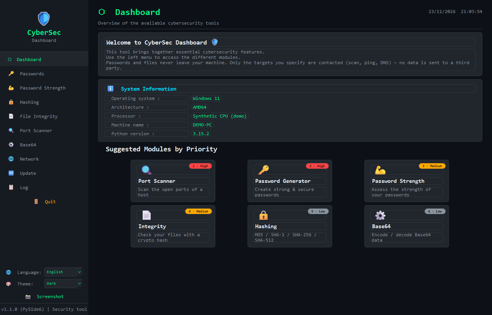
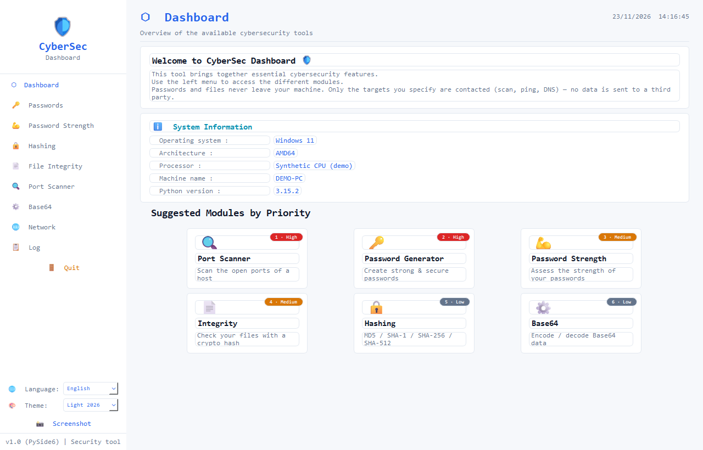

# CyberSec Dashboard

[](https://github.com/CHM2026/Local-Cybersec-Partner/actions/workflows/python-app.yml)
[](https://www.python.org/downloads/)
[](https://pypi.org/project/PySide6/)
[](https://github.com/CHM2026/Local-Cybersec-Partner/actions/workflows/python-app.yml)
[](https://github.com/CHM2026/Local-Cybersec-Partner/releases/latest)
[](https://github.com/CHM2026/Local-Cybersec-Partner/actions/workflows/python-app.yml)

> Languages: [Français](README.md) · **English** · [العربية](README.ar.md)

Local dashboard bringing together several cybersecurity utilities, built with **PySide6**.

## Preview

Dark (original theme):



Light 2026:



> ⚠️ **Requirement: Python 3.15 or later.** The code uses the `lazy import` syntax (PEP 810) and nested f-strings (PEP 701). On Python ≤ 3.14, startup fails with a `SyntaxError`.

## Installation

Python 3.15 or later is required. Depending on your system:

```powershell
# Windows (PowerShell)
python -m venv .venv
.\.venv\Scripts\python.exe -m pip install -r requirements.txt
```

```bash
# macOS / Linux
python3 -m venv .venv
./.venv/bin/python -m pip install -r requirements.txt
```

On Windows, if `python` points to an older version, use `py -3.15` instead.

For development (tests included), replace `requirements.txt` with `requirements.dev.txt` in the install command above.

### Windows: portable or installer (no Python needed)

From the [Releases](https://github.com/CHM2026/Local-Cybersec-Partner/releases)
page, download one of the Windows artifacts:

- `CyberSecDashboard-<version>-portable.zip`: extract it, then run
  `CyberSecDashboard.exe`. The `portable.txt` marker stores preferences in
  `settings.ini` next to the executable (nothing in the registry);
- `CyberSecDashboard-<version>-setup.exe`: regular installation with a Start
  menu shortcut; uninstall from *Settings → Apps*.

Python is not required for either format. The `SHA256SUMS.txt` file attached to
the release lets you verify download integrity.

## Running

### From the repository (development)

```powershell
# Windows
.\.venv\Scripts\python.exe main.py
```

```bash
# macOS / Linux
./.venv/bin/python main.py
```

### After a pip install (end user)

Any pip installation of the package creates the **`cybersec-dashboard`** command,
whether from `pip install -e .`, the Release wheel or the Git tag:

```bash
cybersec-dashboard
```

**Windows — "not recognized"?** Python's `Scripts` folder is missing from `PATH`.
Two options:

- no configuration needed: `py -3.15 -m main`
- or add it once for all (then **restart PowerShell**):

```powershell
$p = "$env:LOCALAPPDATA\Python\pythoncore-3.15-64\Scripts"
$old = [Environment]::GetEnvironmentVariable("Path", "User")
[Environment]::SetEnvironmentVariable("Path", "$old;$p", "User")
```

Adjust `3.15-64` if Python is installed elsewhere on your machine.

## Uninstalling

```powershell
# Windows (global Python 3.15)
py -3.15 -m pip uninstall local-cybersec-partner
```

```bash
# macOS / Linux
python3 -m pip uninstall local-cybersec-partner
```

Use the **package name** (`local-cybersec-partner`), not the command name
(`cybersec-dashboard`). pip also removes the command from the `Scripts` folder.
Your language and theme preferences remain saved.

## Modules

| Module | Description |
|---|---|
| ⬡ Dashboard | System information and prioritized access to the modules |
| 🔑 Passwords | CSPRNG generation via `secrets` (length, character set, quantity) |
| 💪 Password strength | Criteria analysis, score, indicative entropy |
| 🔒 Hashing | MD5, SHA-1, SHA-256, SHA-384, SHA-512 of a text |
| 📄 File integrity | File hash (outside the GUI thread) and comparison with a reference hash |
| 🔍 Port scanner | TCP Connect scan of a port range (resolved host and validated timeout) |
| ⚙️ Base64 | Strict encoding/decoding, with hexadecimal display for binary data |
| 🌐 Network | Local information, asynchronous DNS resolution, ping |
| 🆕 Update | GitHub Releases lookup, guided download and SHA-256 verification |
| 📋 Log | Action history, clearing and text export |

## Multilingual (FR / EN / AR)

The **🌐 Language** selector at the bottom of the sidebar switches between **Français**, **English** and **العربية**. The choice is saved (`QSettings`) and restored on the next launch.

- **Complete interface**: titles, labels, buttons, messages, tooltips and log entries are translated.
- **Retroactive log**: entries are stored as keys with their parameters; they are re-translated on display when the language changes, including in the text export.
- **Automatic RTL**: selecting Arabic reverses the layout (`RightToLeft`) and alignments (`text-align: start`).
- **State preservation**: in-progress inputs are kept and results are recalculated without creating a new log entry.

To add or fix a translation, edit `src/i18n.py`: each key in the `STRINGS` dictionary holds the `(français, english, العربية)` triplet.

## Themes

Two palettes are available from the **🎨 Theme** selector in the sidebar:

- **Dark**: the original cyber theme (`#0d1117` background, green/cyan accents).
- **Light 2026**: a modern light palette (`#f6f8fb` background), blue/cyan accents and `Segoe UI` typography.

The choice is saved (`QSettings`) and restored on launch. The **📸 Screenshot** button saves the current render as PNG.

## Update

The **🆕 Update** page queries the public GitHub API once a day at startup
(disable it with the checkbox), or on demand with **Check now**. It shows the
installed version, the available version and the release notes.

**Download update** picks the artifact matching the current mode:

- **pip** install: the `py -3.15 -m pip install --upgrade …` command is shown and can be copied;
- **portable**: the ZIP archive is extracted into a neighbouring `CyberSecDashboard-vX.Y.Z` folder;
- **Windows installer**: the `-setup.exe` is downloaded to your Downloads folder, then launched only after you confirm.

The connection is **HTTPS only**, the `SHA256SUMS.txt` checksum is verified when
published, and nothing is installed without your approval. In portable mode,
preferences are written to `settings.ini` next to the executable (via the
`portable.txt` marker); in other modes they stay in the system registry.

## Security and scope

- No password, file or hash is sent to a third-party service: everything is processed locally.
- Port scanning, DNS resolution and ping contact **only the target you enter**.
- Only use the scanner on hosts you own or are explicitly authorized to test.
- MD5 and SHA-1 are kept for compatibility; **SHA-256 is recommended** for any integrity check.
- The exported log is an unencrypted text file: do not store it in a shared location.
- On exit, the application stops its threads and clears sensitive data (fields, hashes, log, clipboard if the application owned it).
- The update checker makes **one public HTTPS request** to GitHub (no telemetry, no local data uploaded) and never installs anything automatically.

## Tests

```powershell
# Windows
.\.venv\Scripts\python.exe -m pytest
```

```bash
# macOS / Linux
./.venv/bin/python -m pytest
```

Tests run in Qt `offscreen` mode: no window is opened.

## Screenshots

- **From the app**: click **📸 Screenshot** in the sidebar, then choose the PNG destination.
- **From the terminal** (ideal for documentation and CI):

```bash
python tools/screenshots.py
python tools/screenshots.py --native --theme light
python tools/screenshots.py --pages dashboard,scanner --out docs/screenshots
```

The script generates `docs/screenshots/<page>-<language>-<theme>.png` for French, English and Arabic, in both dark and light variants. By default it runs in `offscreen` mode (no window, ideal for CI), but emoji are rendered in monochrome.

For **colour emoji**, add `--native` (a display is required):

```bash
python tools/screenshots.py --native
```

The images shown above were generated with `--native`. On Windows, use `.\.venv\Scripts\python.exe tools\screenshots.py --native` if needed.

**Privacy:** the machine name and CPU are replaced with `DEMO-PC` and `Synthetic CPU (demo)`, so the screenshots can be published without personal data. Use `--real-data` to disable this anonymisation (local use only). Avoid capturing the **Network** page with real IP addresses.

## Structure

```
main.py              Application (window, pages, worker threads)
src/constants.py     Palette, port table, app name and version
src/i18n.py          FR/EN/AR dictionaries, translation engine, RTL selector
src/runtime.py       pip/installer/portable modes, QSettings
src/updater.py       GitHub Releases, versions, artifacts, SHA-256, safe ZIP
tests/               Automated tests
tools/screenshots.py FR/EN/AR screenshot generator (offscreen)
tools/build_windows.py   PyInstaller --onedir + portable ZIP
tools/write_sha256sums.py Artifact checksums
installer/           Inno Setup script (Windows setup.exe)
requirements.txt     Runtime dependency
requirements.dev.txt Development dependencies
pyproject.toml       Metadata, entry point, pytest configuration
```

## License and release

Distributed under the [MIT license](LICENSE). The version history is in
[CHANGELOG.md](CHANGELOG.md) and the procedure for publishing the `v1.0.0` tag
is in [docs/RELEASE.md](docs/RELEASE.md).
