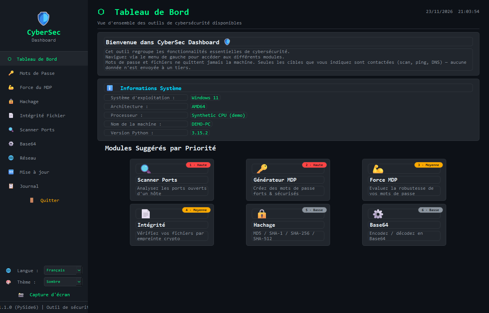
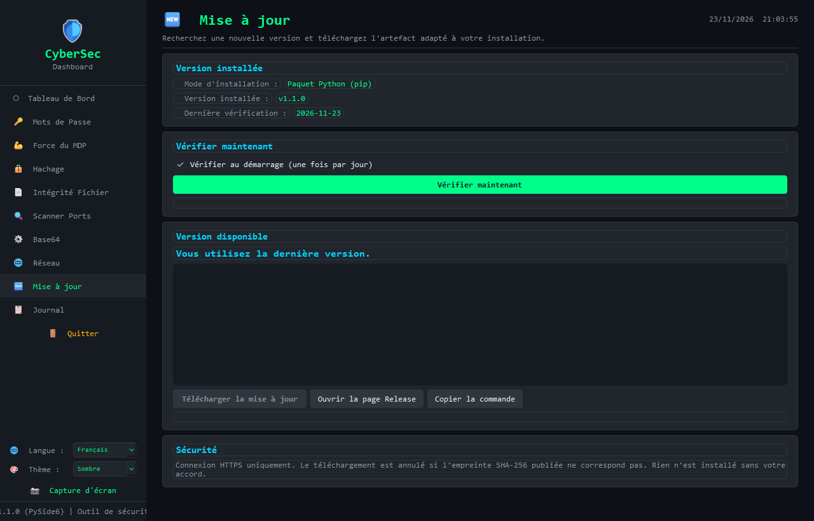

# CyberSec Dashboard

[](https://github.com/CHM2026/Local-Cybersec-Partner/actions/workflows/python-app.yml)
[](https://www.python.org/downloads/)
[](https://pypi.org/project/local-cybersec-partner/)
[](https://github.com/CHM2026/Local-Cybersec-Partner/blob/main/LICENSE)

Tableau de bord local regroupant plusieurs utilitaires de cybersécurité, construit
avec **PySide6** : génération de mots de passe, analyse de force, hachage,
intégrité de fichiers, scan de ports, Base64, réseau, journal et mise à jour
intégrée. Tout est traité localement, sans télémétrie.

## Installation

> ⚠️ **Python 3.15 ou supérieur est requis** (syntaxe `lazy import`, PEP 810).

```powershell
# Windows
py -3.15 -m pip install local-cybersec-partner
cybersec-dashboard
```

```bash
# macOS / Linux
python3 -m pip install local-cybersec-partner
cybersec-dashboard
```

Pour désinstaller : `py -3.15 -m pip uninstall local-cybersec-partner`.

## Aperçu





## Windows sans Python

Si vous ne souhaitez pas installer Python, la page
[Releases](https://github.com/CHM2026/Local-Cybersec-Partner/releases) propose :

- `CyberSecDashboard-<version>-portable.zip` : à décompresser, puis lancer l'exe ;
- `CyberSecDashboard-<version>-setup.exe` : installateur avec désinstallateur ;
- `SHA256SUMS.txt` : empreintes SHA-256 de vérification.

## Mise à jour

L'application interroge une fois par jour l'API publique GitHub (désactivable),
affiche les notes de la Release et télécharge l'artefact adapté. Le téléchargement
est vérifié avec `SHA256SUMS.txt` et **rien n'est installé sans confirmation**.

## Langues et sécurité

Interface complète en **Français**, **English** et **العربية** (RTL automatique).
Aucun mot de passe, fichier ou hash n'est envoyé à un service tiers ; le scanner,
le DNS et le ping ne contactent que la cible saisie. N'utilisez le scanner que sur
des hôtes autorisés. MD5 et SHA-1 sont conservés pour compatibilité ;
**SHA-256 est recommandé**.

## Documentation

- [README français](https://github.com/CHM2026/Local-Cybersec-Partner/blob/main/README.md)
  · [English](https://github.com/CHM2026/Local-Cybersec-Partner/blob/main/README.en.md)
  · [العربية](https://github.com/CHM2026/Local-Cybersec-Partner/blob/main/README.ar.md)
- [Journal des versions](https://github.com/CHM2026/Local-Cybersec-Partner/blob/main/CHANGELOG.md)
- [Procédure de publication](https://github.com/CHM2026/Local-Cybersec-Partner/blob/main/docs/RELEASE.md)
- Licence [MIT](https://github.com/CHM2026/Local-Cybersec-Partner/blob/main/LICENSE) — CHM2026
